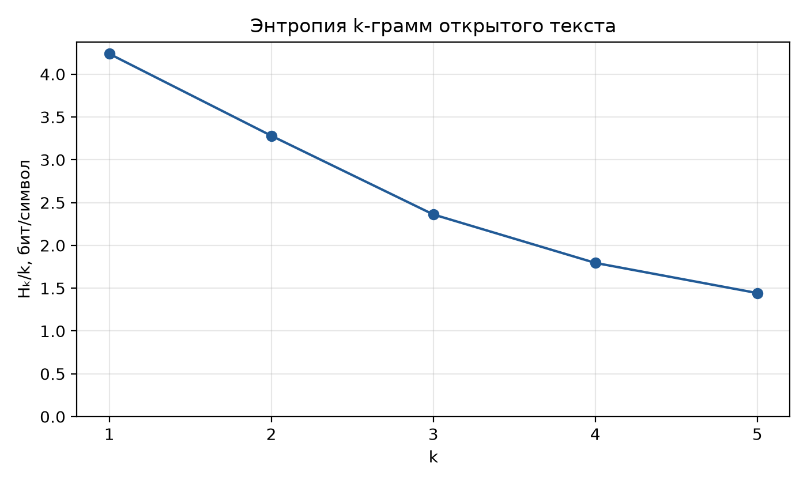

{{json
{
  "discipline": "Математические основы защиты информации",
  "title": "Модель открытого текста",
  "student": {
    "name": "Смирнов Никита Михайлович",
    "course": "2",
    "group": "ФИТ-242",
    "program": "02.03.02 Фундаментальная информатика и информационные технологии"
  },
  "teacher": {
    "title": "канд. пед. наук, доцент",
    "name": "Белим Светлана Юрьевна"
  },
  "institution": {
    "short": "ОмГТУ",
    "department": "ПМиФИ",
    "year": "2026"
  },
  "work": {
    "type": "Лабораторная работа № 3",
    "variant": "16"
  }
}
}}

# СОДЕРЖАНИЕ

# ВВЕДЕНИЕ

Цель лабораторной работы — проведение частотного анализа открытого текста и определение зависимости нормированной энтропии k-грамм от длины k. В работе выполнен вариант 16 из методических указаний: фрагмент стихотворения Михаила Лермонтова «Парус». Рассчитаны абсолютные и относительные частоты перекрывающихся k-грамм, энтропии для k от 1 до 5 и построен график отношения энтропии к длине k-граммы.

Дата выполнения работы: 14.10.2026.

# ОСНОВНАЯ ЧАСТЬ

## Основные сведения

k-грамма — упорядоченный набор из k последовательных символов текста. В данной реализации окна перекрываются: начало следующего окна сдвигается на один символ. Для строки длины N число полных окон равно:

$$
M_k = N-k+1,\qquad N\geq k.
$$

Если k-грамма встречается $n_i$ раз, её относительная частота определяется как:

$$
p_i = \frac{n_i}{M_k},\qquad \sum_i p_i=1.
$$

Энтропия k-грамм открытого текста определяется формулой:

$$
H_k(T)=-\sum_{i=1}^{s_k}p_i\log_2 p_i.
$$

Здесь $s_k$ — число различных наблюдаемых k-грамм. Энтропия измеряется в битах на k-грамму; величина $H_k/k$ измеряется в битах на символ. Суммирование производится только по наблюдаемым k-граммам, поэтому логарифм нулевой вероятности не вычисляется.

При взаимно однозначной простой замене букв абсолютные частоты соответствующих k-грамм сохраняются. Следовательно, сохраняется их энтропия. Это объясняет применение частотных характеристик при криптоанализе моноалфавитных шифров.

## Исходный текст и предобработка

Вариант 16 приведён на странице 28 методических указаний. Анализируется только фрагмент стихотворения, без имени автора и названия произведения. Сохранены формы «одинокой», «скрыпит» и «счастия», использованные в задании.

Белеет парус одинокой

В тумане моря голубом!..

Что ищет он в стране далекой?

Что кинул он в краю родном?..

Играют волны — ветер свищет,

И мачта гнется и скрыпит...

Увы! Он счастия не ищет

И не от счастия бежит!

Перед расчётом регистр приводится к нижнему. Используется подготовка текста из ЛР2: русский алфавит содержит 32 символа, буква «ё» заменяется на «е». Пробелы, переводы строк, цифры, знаки препинания и буквы других алфавитов удаляются. Символы склеиваются в одну строку, поэтому окна могут проходить через бывшие границы слов. Для английского языка предусмотрен алфавит из 26 букв; язык выбирается в TUI.

После предобработки получено 158 букв. Очищенная строка и остальные результаты каждого запуска сохраняются в отдельной датированной папке внутри `outputs/`; в корне `outputs/` остаются копии последнего расчёта.

## Алгоритм и интерфейс программы

1. Ввести текст во вкладке «Текст» либо загрузить его из файла и выбрать язык.
2. Привести текст к канонической строке выбранного алфавита.
3. Для каждого k от 1 до 5 сформировать полные окна с шагом 1.
4. Подсчитать число вхождений каждой k-граммы и разделить его на общее число окон.
5. Вычислить $H_k$ и $H_k/k$, вывести частоты и список энтропий.
6. Сохранить результаты и график, соединяющий пять точек прямыми отрезками.

Пустая после фильтрации строка вызывает понятное сообщение об ошибке. Если длина текста меньше k, значение для этого k помечается как отсутствующее: энтропия не подменяется нулём. Чтение файла поддерживает UTF-8 с BOM и резервную кодировку Windows-1251. Программа не удаляет нехарактерные слова и не выполняет лемматизацию, поскольку анализируются символы исходного текста.

Интерактивный режим запускается командой `python -m lab_3.main`: текст можно вставить в многострочное поле или загрузить из файла, затем выбрать русский или английский язык и нажать «Посчитать». Кнопка «Открыть вариант 16» загружает исходный фрагмент. После расчёта вкладка «Результаты» показывает график и сводку Hk/k; таблица частот позволяет выбрать k от 1 до 5. Полную очищенную строку можно открыть в свёрнутой секции «Обработанный текст». Сочетание `Ctrl+O` открывает PNG-график matplotlib. Команда `python -m lab_3.main --file lab_3/texts/variant_16.txt` выполняет пакетный расчёт и выводит таблицы в консоль.

Число операций при фиксированном диапазоне k от 1 до 5 пропорционально длине текста. Хранение частот требует памяти, пропорциональной числу различных наблюдаемых k-грамм.

## Результаты

Таблица: Энтропия k-грамм для варианта 16

| k | Число окон | Различных k-грамм | Hk, бит | Hk/k, бит/символ |
|---|---|---|---|---|
| 1 | 158 | 24 | 4.237716 | 4.237716 |
| 2 | 157 | 108 | 6.561127 | 3.280564 |
| 3 | 156 | 141 | 7.083416 | 2.361139 |
| 4 | 155 | 148 | 7.180932 | 1.795233 |
| 5 | 154 | 150 | 7.214838 | 1.442968 |

Таблица: Наиболее частые k-граммы

| k | k-грамма | Число вхождений | Относительная частота |
|---|---|---|---|
| 1 | т | 17 | 0.107595 |
| 1 | о | 16 | 0.101266 |
| 1 | е | 15 | 0.094937 |
| 2 | ет | 6 | 0.038217 |
| 2 | не | 5 | 0.031847 |
| 2 | ти | 4 | 0.025478 |
| 3 | ище | 3 | 0.019231 |
| 3 | щет | 3 | 0.019231 |
| 3 | ане | 2 | 0.012821 |
| 4 | ищет | 3 | 0.019355 |
| 4 | асти | 2 | 0.012903 |
| 4 | стия | 2 | 0.012903 |
| 5 | астия | 2 | 0.012987 |
| 5 | ищети | 2 | 0.012987 |
| 5 | счаст | 2 | 0.012987 |

При одинаковых частотах k-граммы упорядочены по алфавиту. В TUI частоты просматриваются в таблице по выбранному k; пакетный режим выводит полные частотные таблицы в консоль. Файлы `frequencies.csv`, `entropy.csv`, `analysis.txt`, исходный и очищенный текст, а также PNG-график сохраняются в отдельной папке с датой и временем внутри выходного каталога; копии последнего расчёта остаются в корне этого каталога.



Полученная ломаная убывает на всех пяти точках. Одновременно ненормированная энтропия $H_k$ возрастает: при увеличении длины окна растёт разнообразие сочетаний. При k=5 наблюдается 150 различных сочетаний на 154 окна, то есть выборка почти полностью состоит из редких k-грамм.

Для оценки предела методические указания предлагают рассмотреть большие значения k. На данной выборке последнее рассчитанное значение равно $H_5/5=1{,}442968$ бит/символ. Его можно использовать как конечную оценку при k=5, но надёжно установить асимптотическую энтропию русского языка по 158 буквам невозможно. Уже различие между значениями при k=4 и k=5 составляет около 0,352265 бит/символ и не свидетельствует о выходе графика на плато.

Для фиксированного конечного текста эмпирическая энтропия ограничена сверху логарифмом числа окон: $H_k\leq\log_2 M_k$. При k=N остаётся одно окно и эмпирическая энтропия равна нулю. Поэтому предельную характеристику языка следует отличать от расчёта по короткому фиксированному фрагменту; она требует существенно большей выборки.

## Проверка корректности

Проверены фильтрация по русскому и английскому алфавитам, замена «ё» на «е», перекрывающиеся окна, текст из одной буквы, строка одинаковых букв, пустой результат фильтрации и сохранение энтропии при взаимно однозначной замене символов.

Для контрольной строки «абаба» биграммы «аб» и «ба» встречаются по два раза, поэтому их вероятности равны 0,5, энтропия $H_2=1$ бит, а $H_2/2=0{,}5$ бит/символ. Количество окон для k от 1 до 5 равно 5, 4, 3, 2, 1 соответственно. На строке одинаковых букв энтропии всех доступных k-грамм равны нулю.

Команда `python -m pytest -q` завершилась успешно: пройден 121 тест, включая пять тестов ЛР3 и проверки ранее реализованных лабораторных работ.

# ЗАКЛЮЧЕНИЕ

Реализован частотный анализ открытого текста с вводом в TUI или загрузкой из файла, выбором языка, очисткой до символов целевого алфавита и вычислением энтропии перекрывающихся k-грамм для k от 1 до 5. Для варианта 16 получены пять значений нормированной энтропии и построен график. Нормированная энтропия снижается с 4,237716 до 1,442968 бит/символ. Рассчитанные значения характеризуют данный фрагмент текста; короткая выборка не позволяет надёжно определить асимптотическую энтропию языка.

# СПИСОК ЛИТЕРАТУРЫ

- Математические основы защиты информации: методические указания к лабораторным работам. Лабораторная работа № 3 «Модель открытого текста». С. 24–30. Приложение 3. С. 52.

# ПРИЛОЖЕНИЯ

## Код программы

Вычислительное ядро использует модель алфавита `lab_2.alphabet.get_alphabet`; чтение файлов выполняется функцией `common.io_utils.read_text_file` из предыдущих лабораторных работ. Ниже приведён актуальный код модулей расчёта, пакетного запуска и TUI.

Листинг: Модуль entropy.py

```python
"""Предобработка и эмпирическая энтропия перекрывающихся k-грамм."""

from collections import Counter
from dataclasses import dataclass
from math import fsum, log2

from lab_2.alphabet import get_alphabet


@dataclass
class GramStatistics:
    """Число окон, абсолютные частоты и энтропия для одного k."""

    k: int
    counts: Counter[str]
    total: int
    entropy: float | None

    @property
    def normalized(self) -> float | None:
        """Средняя энтропия на символ Hk/k; None при отсутствии окон."""
        return None if self.entropy is None else self.entropy / self.k


def prepare_text(text: str, language: str = "ru") -> str:
    """Склеить буквы выбранного алфавита, учитывая нормализацию ЛР2."""
    return get_alphabet(language).prepare_canonical_text(text)


def analyze(text: str) -> list[GramStatistics]:
    """Рассчитать частоты и Hk для k=1..5 по уже очищенной строке.

    Окна идут с шагом 1. Знаменатель вероятности равен N-k+1.
    Короткий текст не дополняется символами; неполных окон нет.
    """
    if not text:
        raise ValueError("После предобработки не осталось букв выбранного языка.")
    results = []
    for k in range(1, 6):
        counts = Counter(text[i : i + k] for i in range(len(text) - k + 1))
        total = sum(counts.values())
        entropy = -fsum((n / total) * log2(n / total) for n in counts.values()) if total else None
        results.append(GramStatistics(k, counts, total, entropy))
    return results
```

Листинг: Модуль main.py

```python
"""TUI и пакетный запуск: python -m lab_3.main."""

import argparse
import csv
from datetime import datetime
from pathlib import Path
import shutil

from common.io_utils import read_text_file
from lab_3.entropy import analyze, prepare_text

OUTPUT = Path(__file__).resolve().parent / "outputs"
VARIANT = Path(__file__).resolve().parent / "texts" / "variant_16.txt"


def save_plot(results, path: Path) -> None:
    """Сохранить ломаную Hk/k в PNG без открытия графического окна."""
    import matplotlib

    matplotlib.use("Agg")
    import matplotlib.pyplot as plt

    fig, ax = plt.subplots(figsize=(7, 4.2))
    ax.plot(
        [r.k for r in results],
        [r.normalized if r.normalized is not None else float("nan") for r in results],
        "o-",
        color="#215a96",
    )
    ax.set(
        xlabel="k",
        ylabel="Hₖ/k, бит/символ",
        title="Энтропия k-грамм открытого текста",
        xticks=range(1, 6),
    )
    ax.set_ylim(bottom=0)
    ax.grid(alpha=0.3)
    fig.tight_layout()
    fig.savefig(path, dpi=200)
    plt.close(fig)


def run_analysis(text: str, language: str, output: Path = OUTPUT) -> Path:
    """Вывести анализ и сохранить отдельный архив вычисления с графиком."""
    cleaned = prepare_text(text, language)
    results = analyze(cleaned)
    output.mkdir(parents=True, exist_ok=True)
    run_dir = output / datetime.now().strftime("%Y-%m-%d_%H-%M-%S_%f")
    run_dir.mkdir()
    lines = [
        f"Язык: {language}; букв после обработки: {len(cleaned)}",
        f"Очищенный текст: {cleaned}",
        "Перекрывающиеся k-граммы, шаг 1.",
    ]
    with (run_dir / "frequencies.csv").open("w", encoding="utf-8-sig", newline="") as f:
        writer = csv.writer(f)
        writer.writerow(["k", "gram", "count", "probability"])
        for r in results:
            lines.append(f"\nk={r.k}; окон: {r.total}; различных: {len(r.counts)}")
            for gram, n in sorted(r.counts.items(), key=lambda x: (-x[1], x[0])):
                p = n / r.total
                lines.append(f"{gram}: {n}; p={p:.8f}")
                writer.writerow([r.k, gram, n, p])
    lines.append("\nk    Hk, бит    Hk/k, бит/символ")
    with (run_dir / "entropy.csv").open("w", encoding="utf-8-sig", newline="") as f:
        writer = csv.writer(f)
        writer.writerow(["k", "windows", "unique", "Hk", "Hk/k"])
        for r in results:
            writer.writerow([r.k, r.total, len(r.counts), r.entropy, r.normalized])
            lines.append(
                f"{r.k}    {r.entropy:.8f}    {r.normalized:.8f}"
                if r.entropy is not None
                else f"{r.k}    нет данных"
            )
    lines.append(f"Hk: {[r.entropy for r in results]}")
    lines.append(f"Hk/k: {[r.normalized for r in results]}")
    content = "\n".join(lines)
    (run_dir / "analysis.txt").write_text(content, encoding="utf-8")
    (run_dir / "prepared.txt").write_text(cleaned, encoding="utf-8")
    save_plot(results, run_dir / "entropy.png")
    (run_dir / "input.txt").write_text(text, encoding="utf-8")
    # Обновить удобные ссылки на последний расчёт и совместимость отчёта.
    for name in (
        "analysis.txt",
        "prepared.txt",
        "frequencies.csv",
        "entropy.csv",
        "entropy.png",
        "input.txt",
    ):
        shutil.copy2(run_dir / name, output / name)
    print(content)
    print(f"\nРезультаты этого расчёта сохранены: {run_dir.resolve()}")
    return run_dir


def main() -> None:
    """Выбрать интерактивный или воспроизводимый файловый режим."""
    parser = argparse.ArgumentParser(description=__doc__)
    parser.add_argument("--file", type=Path)
    parser.add_argument("--language", choices=("ru", "en"), default="ru")
    parser.add_argument("--output", type=Path, default=OUTPUT)
    args = parser.parse_args()
    try:
        if args.file:
            run_analysis(read_text_file(str(args.file)), args.language, args.output)
        else:
            from lab_3.tui import EntropyApp

            EntropyApp(output=args.output, language=args.language).run()
    except (OSError, UnicodeError, ValueError) as exc:
        parser.exit(1, f"Ошибка: {exc}\n")
    except (EOFError, KeyboardInterrupt):
        print("\nВвод завершён.")


if __name__ == "__main__":
    main()
```

Листинг: Модуль tui.py

```python
"""Экранный интерфейс для запуска анализа и просмотра результата."""

from __future__ import annotations

from contextlib import redirect_stdout
from io import StringIO
from pathlib import Path

from textual.app import App, ComposeResult
from textual.containers import Horizontal
from textual.events import Resize
from textual.widgets import (
    Button,
    Collapsible,
    DataTable,
    Footer,
    Header,
    Input,
    Select,
    Static,
    TabPane,
    TabbedContent,
    TextArea,
)
from textual_plotext import PlotextPlot

from common.io_utils import read_text_file
from lab_3.entropy import GramStatistics, analyze, prepare_text
from lab_3.main import OUTPUT, VARIANT, run_analysis


class EntropyApp(App[None]):
    """Интерфейс ввода, анализа, графика и прокручиваемых частот."""

    TITLE = "ЛР3 · Модель открытого текста"
    SUB_TITLE = "Энтропия k-грамм"
    ENABLE_COMMAND_PALETTE = True
    CSS = """
    Screen { layout: vertical; background: $surface; }
    Header { background: $primary-darken-2; }
    #toolbar {
        height: 4; padding: 0 1; align: center middle; background: $panel;
        border-bottom: solid $primary-darken-2;
    }
    #language { width: 20; height: 3; margin: 0 1 0 0; }
    #run { width: 17; height: 3; padding: 0 1; margin: 0 1 0 0; }
    #example { width: 22; height: 3; padding: 0 1; margin: 0; }
    #main-views { height: 1fr; min-height: 8; margin: 0 1; }
    #main-views > ContentSwitcher { height: 1fr; }
    #main-views TabPane { height: 1fr; padding: 1; }
    #input-area { height: 1fr; min-height: 5; border: round $primary; }
    #file-row { height: 3; padding: 0; margin-top: 1; }
    #file-path { width: 1fr; }
    #load { width: 18; margin-left: 1; }
    #output-row { height: 3; margin-top: 0; }
    #output-path { width: 1fr; }
    #input-hint { height: 2; color: $text-muted; padding: 0 1; }
    #prepared-collapse { height: auto; margin: 0 0 1 0; }
    #prepared-area { height: 6; min-height: 3; border: round $primary-darken-2; }
    #summary { height: 2; padding: 0 1; color: $success; text-style: bold; }
    #result-views { height: 1fr; min-height: 7; }
    #result-views > ContentSwitcher { height: 1fr; }
    #result-views TabPane { height: 1fr; padding: 0 1; }
    #chart { width: 1fr; height: 1fr; min-height: 5; background: $panel; }
    #k-filter { height: 3; padding: 0 1; }
    #k-select { width: 20; margin-right: 1; }
    #gram-table { height: 1fr; border: round $primary-darken-2; }
    DataTable > .datatable--header { background: $primary-darken-2; color: $text; text-style: bold; }
    #status { height: 1; padding: 0 1; color: $text-muted; }
    Footer { background: $panel; }
    """

    BINDINGS = [
        ("ctrl+enter", "analyze", "Анализировать"),
        ("ctrl+o", "open_plot", "PNG-график"),
        ("ctrl+q", "quit", "Выход"),
    ]

    def __init__(
        self, initial_file: Path | None = None, output: Path = OUTPUT, language: str = "ru"
    ):
        super().__init__()
        self.theme = "nord"
        self.initial_file = initial_file
        self.output = output
        self.language = language
        self.results: list[GramStatistics] = []
        self.original_text = ""
        self.last_run_dir: Path | None = None

    def compose(self) -> ComposeResult:
        yield Header()
        with Horizontal(id="toolbar"):
            yield Select(
                [("Русский", "ru"), ("English", "en")], value="ru", allow_blank=False, id="language"
            )
            yield Button("Посчитать", variant="primary", id="run")
            yield Button("Открыть вариант 16", id="example")
        with TabbedContent(initial="input-tab", id="main-views"):
            with TabPane("Текст", id="input-tab"):
                yield Static("Вставьте текст ниже или загрузите его из файла.", id="input-hint")
                yield TextArea(
                    id="input-area",
                    soft_wrap=True,
                    show_line_numbers=False,
                    placeholder="Введите или вставьте текст…",
                )
                with Collapsible(
                    title="Обработанный текст", collapsed=True, id="prepared-collapse"
                ):
                    yield TextArea(
                        read_only=True, soft_wrap=True, show_line_numbers=False, id="prepared-area"
                    )
                with Horizontal(id="file-row"):
                    yield Input(placeholder="Путь к текстовому файлу", id="file-path")
                    yield Button("Загрузить файл", id="load")
                with Horizontal(id="output-row"):
                    yield Input(
                        value=str(self.output),
                        placeholder="Папка для отчёта и результатов",
                        id="output-path",
                    )
            with TabPane("Результаты", id="results-tab"):
                yield Static(
                    "Пока нет результатов. Нажмите «Посчитать» на вкладке «Текст».", id="summary"
                )
                with TabbedContent(initial="chart-tab", id="result-views"):
                    with TabPane("График Hₖ/k", id="chart-tab"):
                        yield PlotextPlot(id="chart")
                    with TabPane("Частоты k-грамм", id="frequency-tab"):
                        with Horizontal(id="k-filter"):
                            yield Select(
                                [(f"k = {k}", k) for k in range(1, 6)],
                                value=1,
                                allow_blank=False,
                                id="k-select",
                            )
                            yield Static("Отсортировано по частоте; список можно прокручивать.")
                        yield DataTable(id="gram-table", zebra_stripes=True, cursor_type="row")
        yield Static("", id="status")
        yield Footer()

    def on_mount(self) -> None:
        self.query_one("#language", Select).value = self.language
        self.query_one("#output-path", Input).value = str(self.output)
        self.query_one("#input-area", TextArea).focus()
        self.update_prepared_text()
        table = self.query_one("#gram-table", DataTable)
        table.add_columns("k-грамма", "Количество", "Частота")
        if self.initial_file:
            self.query_one("#file-path", Input).value = str(self.initial_file)
            self.load_file(self.initial_file)

    def set_status(self, message: str) -> None:
        self.query_one("#status", Static).update(message)

    def load_file(self, path: Path) -> None:
        try:
            text = read_text_file(str(path))
        except (OSError, UnicodeError) as exc:
            self.set_status(f"Не удалось открыть файл: {exc}")
            return
        self.query_one("#input-area", TextArea).text = text
        self.set_status(f"Загружено: {path} · {len(text)} символов")

    def on_button_pressed(self, event: Button.Pressed) -> None:
        if event.button.id == "run":
            self.action_analyze()
        elif event.button.id == "load":
            raw_path = self.query_one("#file-path", Input).value.strip().strip('"')
            if not raw_path:
                self.set_status("Укажите путь к файлу.")
                return
            self.load_file(Path(raw_path))
        elif event.button.id == "example":
            self.query_one("#language", Select).value = "ru"
            self.query_one("#file-path", Input).value = str(VARIANT)
            self.load_file(VARIANT)
            self.query_one("#main-views", TabbedContent).active = "input-tab"

    def on_select_changed(self, event: Select.Changed) -> None:
        if event.select.id == "k-select" and self.results:
            self.update_frequency_table(int(event.value))
        elif event.select.id == "language":
            self.update_prepared_text()

    def on_text_area_changed(self, event: TextArea.Changed) -> None:
        if event.text_area.id == "input-area":
            self.update_prepared_text()

    def update_prepared_text(self) -> None:
        """Обновить отдельное поле очищенной строкой выбранного алфавита."""
        raw = self.query_one("#input-area", TextArea).text
        language = str(self.query_one("#language", Select).value)
        cleaned = prepare_text(raw, language) if raw else ""
        self.query_one("#prepared-area", TextArea).text = cleaned

    def action_analyze(self) -> None:
        raw = self.query_one("#input-area", TextArea).text
        language = str(self.query_one("#language", Select).value)
        output_text = self.query_one("#output-path", Input).value.strip().strip('"')
        if not output_text:
            self.set_status("Укажите папку для отчёта и результатов.")
            return
        output_dir = Path(output_text).expanduser()
        try:
            cleaned = prepare_text(raw, language)
            results = analyze(cleaned)
            # Пакетный запуск сохраняет те же CSV и PNG, не загрязняя экран выводом.
            with redirect_stdout(StringIO()):
                run_dir = run_analysis(raw, language, output_dir)
        except (OSError, UnicodeError, ValueError) as exc:
            self.set_status(f"Ошибка: {exc}")
            return

        self.original_text = raw
        self.results = results
        self.last_run_dir = run_dir
        n = len(cleaned)
        values = [
            f"{r.k}={r.normalized:.2f}" if r.normalized is not None else f"{r.k}:—" for r in results
        ]
        self.query_one("#summary", Static).update(
            f"{language.upper()} · {n} букв · исключено: {len(raw) - n}  Hₖ/k: "
            + " · ".join(values)
        )
        self.update_frequency_table(int(self.query_one("#k-select", Select).value))
        self.query_one("#main-views", TabbedContent).active = "results-tab"
        self.query_one("#result-views", TabbedContent).active = "chart-tab"
        self.call_after_refresh(self.refresh_chart)
        self.set_status(f"Готово · Результаты и график: {run_dir.resolve()}")

    def on_resize(self, event: Resize) -> None:
        """Подгонять размер графика под доступную область окна."""
        if self.results and self.query_one("#main-views", TabbedContent).active == "results-tab":
            self.call_after_refresh(self.refresh_chart)

    def refresh_chart(self) -> None:
        """Построить более плавный график в терминале с braille-разрешением Plotext."""
        chart = self.query_one("#chart", PlotextPlot)
        plt = chart.plt
        plt.clear_figure()
        valid = [r for r in self.results if r.normalized is not None]
        if not valid:
            chart.refresh()
            return
        xs = [r.k for r in valid]
        ys = [r.normalized for r in valid]
        plt.plot(xs, ys, marker="braille", color="cyan+")
        plt.scatter(xs, ys, marker="hd", color="white+")
        plt.title("Нормированная энтропия Hₖ/k")
        plt.xlabel("k — длина k-граммы")
        plt.ylabel("Бит на символ")
        plt.xlim(0.8, 5.2)
        plt.xticks([1, 2, 3, 4, 5])
        plt.ylim(0, max(1.0, max(ys) * 1.15))
        plt.grid(True, False)
        chart.refresh()

    def action_open_plot(self) -> None:
        """Открыть сохранённый matplotlib-график в просмотрщике изображений."""
        if self.last_run_dir is None:
            self.set_status("Сначала выполните расчёт — PNG-график появится в папке результатов.")
            return
        path = self.last_run_dir / "entropy.png"
        try:
            import os

            os.startfile(str(path))
        except (AttributeError, OSError) as exc:
            self.set_status(f"Не удалось открыть PNG: {exc} · Файл: {path.resolve()}")
            return
        self.set_status(f"Открыт график matplotlib: {path.resolve()}")

    def update_frequency_table(self, k: int) -> None:
        table = self.query_one("#gram-table", DataTable)
        table.clear()
        result = next((r for r in self.results if r.k == k), None)
        if result is None or not result.total:
            self.set_status(f"Для k={k} нет полных k-грамм.")
            return
        for gram, count in sorted(result.counts.items(), key=lambda item: (-item[1], item[0])):
            table.add_row(gram, str(count), f"{count / result.total:.6f}")
        self.set_status(
            f"k={k} · окон: {result.total} · различных k-грамм: {len(result.counts)} · "
            "таблица прокручивается колесом мыши или клавишами ↑/↓"
        )


def main() -> None:
    """Запустить TUI с пустым полем или сразу загрузить заданный файл."""
    import argparse

    parser = argparse.ArgumentParser(description=__doc__)
    parser.add_argument("--file", type=Path, help="Предзагрузить файл в TUI")
    parser.add_argument("--language", choices=("ru", "en"), default="ru")
    parser.add_argument("--output", type=Path, default=OUTPUT)
    args = parser.parse_args()
    app = EntropyApp(args.file, args.output, args.language)
    app.run()


if __name__ == "__main__":
    main()
```
