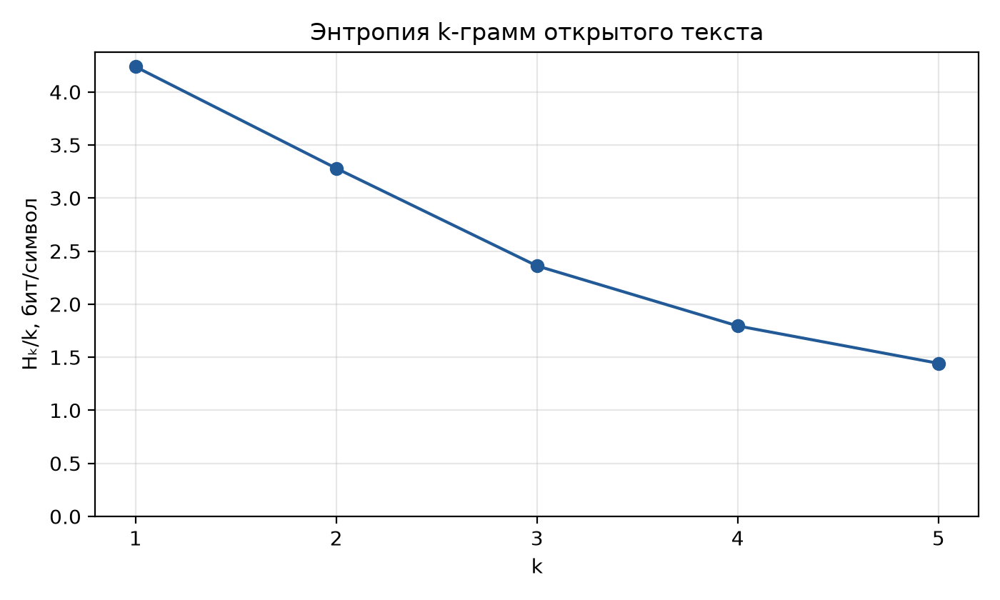

{{json
{
  "discipline": "Математические основы защиты информации",
  "student": {
    "name": "Смирнов Никита Михайлович",
    "course": "2",
    "group": "ФИТ-242",
    "program": "02.03.02 Фундаментальная информатика и информационные технологии"
  },
  "teacher": {
    "title": "канд. пед. наук, доцент",
    "name": "Белим Светлана Юрьевна"
  },
  "institution": {
    "short": "ОмГТУ",
    "full_name": "Омский государственный технический университет",
    "department": "ПМиФИ",
    "city": "Омск",
    "year": "2026"
  },
  "title": "Модель открытого текста",
  "work": {
    "type": "Лабораторная работа № 3",
    "variant": "16"
  }
}
}}

# СОДЕРЖАНИЕ

# ОСНОВНАЯ ЧАСТЬ

## Расчёт варианта 16

Введённый вариант — фрагмент «Парус» М. Ю. Лермонтова. После перевода в нижний регистр, замены «ё» на «е» и удаления символов вне русского алфавита получено $N=158$ букв. Перекрывающиеся окна сдвигаются на один символ; число окон равно $N-k+1$. Для частоты $p_i=n_i/(N-k+1)$ вычислены $H_k=-\sum_i p_i\log_2 p_i$ и $H_k/k$.

Таблица: Энтропия и число наблюдаемых k-грамм

| $k$ | Число окон | Различных k-грамм | $H_k$, бит | $H_k/k$, бит/символ |
|---:|---:|---:|---:|---:|
| 1 | 158 | 24 | 4.237716 | 4.237716 |
| 2 | 157 | 108 | 6.561127 | 3.280564 |
| 3 | 156 | 141 | 7.083416 | 2.361139 |
| 4 | 155 | 148 | 7.180932 | 1.795233 |
| 5 | 154 | 150 | 7.214838 | 1.442968 |

Таблица: Три наиболее частые k-граммы для каждого $k$

| $k$ | k-грамма | Количество | Относительная частота |
|---:|:---:|---:|---:|
| 1 | `т` | 17 | 0.107595 |
| 1 | `о` | 16 | 0.101266 |
| 1 | `е` | 15 | 0.094937 |
| 2 | `ет` | 6 | 0.038217 |
| 2 | `не` | 5 | 0.031847 |
| 2 | `ти` | 4 | 0.025478 |
| 3 | `ище` | 3 | 0.019231 |
| 3 | `щет` | 3 | 0.019231 |
| 3 | `ане` | 2 | 0.012821 |
| 4 | `ищет` | 3 | 0.019355 |
| 4 | `асти` | 2 | 0.012903 |
| 4 | `стия` | 2 | 0.012903 |
| 5 | `астия` | 2 | 0.012987 |
| 5 | `ищети` | 2 | 0.012987 |
| 5 | `счаст` | 2 | 0.012987 |



Последняя точка расчёта — $H_5/5=1.442968$ бит/символ. Это конечная оценка по имеющемуся фрагменту; по пяти значениям для текста длиной 158 букв надёжно определить предел при $k\to\infty$ нельзя. Программа сохраняет график, энтропии и частоты в `lab_3/outputs/`; расчёт реализован в `lab_3/entropy.py`, интерфейс — в `lab_3/tui.py`.


## Работа приложения

Запуск TUI: `python -m lab_3.main`; для пакетного запуска можно передать файл параметром `--file`. На вкладке «Текст» вводится или загружается файл, выбирается русский/английский язык и папка сохранения. «Посчитать» выполняет очистку, строит график и открывает вкладку результатов; там доступны сводка, график $H_k/k$ и прокручиваемые частоты с выбором $k$. Обработанная строка показана в свёрнутом поле. Каждое вычисление сохраняет PNG-график, CSV-таблицы и текстовый результат в отдельную папку внутри `lab_3/outputs/` либо указанного каталога.

Листинг: Подсчёт перекрывающихся k-грамм и энтропии (`lab_3/entropy.py`)

```python
from collections import Counter
from math import fsum, log2

def analyze(text: str) -> list[GramStatistics]:
    """Рассчитать частоты и Hk для k=1..5 по уже очищенной строке.

    Окна идут с шагом 1. Знаменатель вероятности равен N-k+1.
    Короткий текст не дополняется символами; неполных окон нет.
    """
    if not text:
        raise ValueError("После предобработки не осталось букв выбранного языка.")
    results = []
    for k in range(1, 6):
        counts = Counter(text[i : i + k] for i in range(len(text) - k + 1))
        total = sum(counts.values())
        entropy = -fsum((n / total) * log2(n / total) for n in counts.values()) if total else None
        results.append(GramStatistics(k, counts, total, entropy))
    return results
```

# СПИСОК ЛИТЕРАТУРЫ

- Математические основы защиты информации : методические указания к лабораторным работам / Минобрнауки России, Омский государственный технический университет ; составители С. Ю. Белим, С. В. Белим. — Омск : Издательство ОмГТУ, 2023. — С. 24–31, приложение 3. — Текст : электронный.
